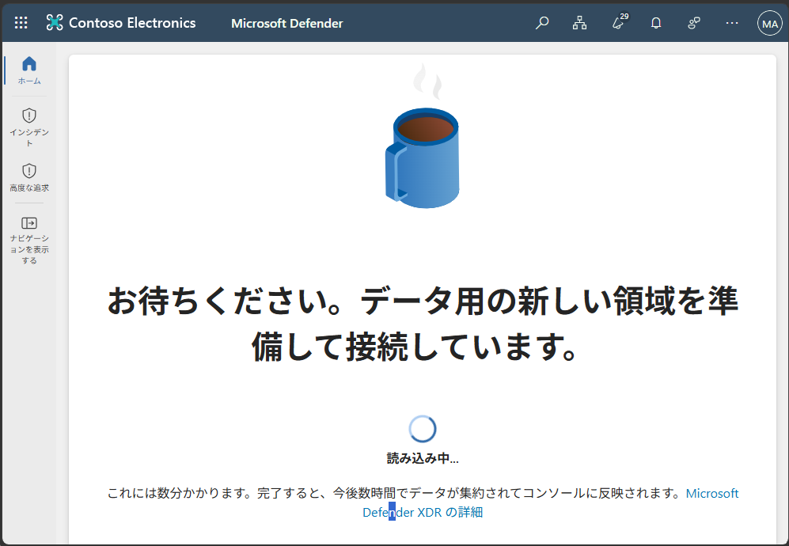

## WWL テナント - 使用条件

講師が指導するトレーニング配信の一環としてテナントを提供されている場合は、講師が指導するトレーニングでハンズオンラボをサポートする目的でテナントを利用できることに注意してください。

テナントを共有したり、ハンズオンラボ以外の目的で使用したりしないでください。 このコースで使われるテナントは試用版テナントであり、クラスが終了し、拡張機能の対象となっていない場合は、使用したりアクセスしたりすることはできません。

テナントを有料サブスクリプションに変換することはできません。 このコースの一環として取得したテナントは Microsoft Corporation の財産のままであり、当社はいつでもアクセス権とリポジトリを取得する権利を留保します。

# ラボのセットアップ - 管理環境を準備する

このラボでは、管理タスク用に環境を構成して準備します。 必要な機能を有効にし、アクセス許可を構成し、管理用にコア サービスを準備します。

**タスク**:

1. Microsoft Purview ポータルで監査を有効にする  
1. デバイスのオンボードを有効にする  
1. インサイダー リスク分析とデータ共有を有効にする  
1. Microsoft Defender XDR を初期化する
1. Microsoft Entra で多要素認証を構成する

**推定所要時間:** 30 ～ 45 分

## タスク 1 - Microsoft Purview ポータルで監査を有効にする

このタスクでは、Microsoft Purview ポータルで監査を有効にして、ポータル アクティビティを監視します。

1. Microsoft Edge をInprivateウィンドウで開きます。

1. **Microsoft Edge** で、`https://purview.microsoft.com` に移動し、**MOD 管理者**である `admin@WWLxZZZZZZ.onmicrosoft.com` としてサインインします (この ZZZZZZ は、ラボ ホスティング プロバイダーから提供された自分専用のテナント プレフィックスです)。 管理者のパスワードは、ラボ ホスティング プロバイダーから支給されます。

1. 新しい Microsoft Purview ポータルに関するメッセージが画面に表示されます。 **[Get Started]** を選択して、新しいポータルにアクセスします。

    ![[ようこそ新しい Microsoft Purview ポータルへ] 画面のスクリーンショット。](../Media/welcome-purview-portal.png)

1. 以下の流れで、日本語表示/タイムゾーン日本に変更してください。

    ------------------------

    ​	画面右上の 歯車マーク をクリックし、表示される [Settings] メニューをクリックします。

    ​	[Setting] の一覧から、 [Language and time zone] の [Change your language] をクリックします。

    

    ![[]](../Media/lab1-2.png)

    ​																																									

    ​	[My Account] の [Settings ＆ Privacy] ページが表示されます。

    ​	[Language] セクションの [Display Language] をクリックして、 [Change display language] をクリックします。

    ![[]](../Media/lab1-3.png)

    ​	[Language] ページで [Japanese] を選択し、 [Select] をクリックします。

    ​	[Display language and regional format will be updated to Japanese] とメッセージが表示されたら、 [Update] をクリックします。

    ![[]](../Media/lab1-4.png)

    ​	[表示言語と地域設定が Japanese に更新されました。新しい言語を完全に適用するには、サインアウトする必要があります。] とメッセージが表示されたら、 [キャンセル] をクリックします。

    ![[]](../Media/lab1-5.png)

    ​	[設定およびプライバシー] ページで、 [地域] の [タイムゾーン] - [タイムゾーンの変更] をクリックします。

    ![[]](../Media/lab1-6.png)

    ​	[ (UTC ＋ 09:00)大阪、札幌、東京] を選択して、 [選択] をクリックします。

    ​	Microsoft 365 ポータル の右上にあるイニシャルのアイコンをクリックしてから、 [sign out] をクリックしてサインアウトします。

    ![[]](../Media/lab1-7.png)

    ​	サインアウトが完了したら、一度ブラウザーを×で閉じます。

    ​	https://admin.microsoft.com に再度サインインします。

    ​	日本語化されたことが確認できたら(少し時間がかかったり、再サインインを要することもあります)、手順を進めてください。						

    ------------------------

1. 左側のサイド バーから **[ソリューション]** を選択し、**[監査]** を選択します。

1. **[検索]** ページで、**[ユーザーと管理者のアクティビティの記録を開始する]** バーを選択して監査ログを有効にします。

    ![[ユーザーと管理者のアクティビティの記録を開始する] ボタンを示すスクリーンショット。](../Media/enable-audit-button.png)

1. このオプションを選択すると、このページに青いバーが表示されなくなるはずです。

    >[!Note] **注:[監査] ボタンでログが有効にならない場合**
    >
    >一部のテナントでは、**[ユーザーと管理者のアクティビティの記録を開始する]** を選択しても監査が有効にならないことがあります。  
    >
    >このような場合は、代わりにClient 1 VM (SC-401-CL1) に **SC-401-CL1\admin** アカウントでログインし、 PowerShell を使用して監査を有効にすることができます。
    >
    >1. Windows ボタンを右クリックし、**[ターミナル (管理者)]** を選択して、管理者特権のターミナル ウィンドウを開きます。  
    >
    >1. 最新の **Exchange Online PowerShell** モジュールをインストールします。
    >
    >     ```powershell
    >     Install-Module ExchangeOnlineManagement
    >     ```
    >
    >     すべてのプロンプトに対して「**Y**」(Yes を示します) と入力し、**Enter** キーを押します。
    >
    >1. 次のコマンドを実行して、実行ポリシーを変更します。
    >
    >     ```powershell
    >     Set-ExecutionPolicy -ExecutionPolicy RemoteSigned -Scope CurrentUser
    >     ```
    >
    >1. 管理者特権のターミナル ウィンドウを閉じて、通常の PowerShell セッションを開きます。
    >
    >1. Exchange Online に接続します。
    >
    >     ```powershell
    >     Connect-ExchangeOnline
    >     ```
    >
    >    `admin@WWLxZZZZZZ.onmicrosoft.com` としてサインインします (この ZZZZZZ は、ラボ ホスティング プロバイダーから提供された自分専用のテナント プレフィックスです)。 管理者のパスワードは、ラボ ホスティング プロバイダーから支給されます。
    >
    >1. [監査] が有効になっているかどうかを確認します。
    >
    >     ```powershell
    >     Get-AdminAuditLogConfig | FL UnifiedAuditLogIngestionEnabled
    >     ```
    >
    >    **_False_** が返された場合は、[監査] を有効にします。
    >
    >     ```powershell
    >     Set-AdminAuditLogConfig -UnifiedAuditLogIngestionEnabled $true
    >     ```
    >
    >1. 有効になっていることを確認します。
    >
    >     ```powershell
    >     Get-AdminAuditLogConfig | FL UnifiedAuditLogIngestionEnabled
    >     ```
    >
    >    [監査] が有効になると、このコマンドにより **_True_** が返されます。

Microsoft 365 で監査を正常に有効にしました。

## タスク 2: デバイスのオンボードを有効にする

このタスクでは、組織向けにデバイスのオンボードを有効にします。

1. Microsoft Purview には MOD 管理者アカウントでログインしている必要があります。

1. 左側のサイドバーから **[設定]** を選択し、**[デバイスのオンボード]** を展開します。

1. **[デバイスのオンボード]** ページで、**[デバイス]** を選択します。

1. **[デバイス]** ページで、**[デバイスのオンボードをオンにする]** を選択し **[OK]** を選択して確認します。

1. プロンプトが表示されたら、**[OK]** を選択して、デバイスの監視が有効になっていることを確認します。

これでデバイスのオンボーディングが有効となりました。デバイスをエンドポイント DLP ポリシーで保護するためにオンボードを開始できます。 この機能を有効にするプロセスには、最大 30 分かかる場合があります。

## タスク 3 - インサイダー リスク分析とデータ共有を有効にする

このタスクでは、インサイダー リスク管理の分析とデータ共有を有効にします。

1. Microsoft Purview には MOD 管理者アカウントでログインしている必要があります。

1. Microsoft Purview で、**[設定]** > **[インサイダー リスク管理]** > **[分析]** に移動します。

1. これらの設定を **[オン]** に切り替えます。

   - **テナント レベルで分析情報を表示する**

   - **ユーザー レベルで分析情報を表示する**

1. ページの下部にある **[保存]** を選択します。

1. 左側のナビゲーション ウィンドウで **[データ共有]** を選択します。

1. [データ共有] セクションで、**[ユーザー リスクの詳細を他のセキュリティ ソリューションと共有する]** を **[オン]** に切り替えます。

1. ページの下部にある **[保存]** を選択します。

インサイダー リスク管理の分析とデータ共有を有効にしました。


## タスク 4 - Microsoft Defender XDR を初期化する

このタスクでは、Microsoft Defender に移動し、Microsoft Defender XDR が初期化されるまで待機します。

1. Microsoft Purview には MOD 管理者アカウントでログインしている必要があります。

1. **Microsoft Edge** で、**`https://security.microsoft.com/`** に移動して Microsoft Defender を開きます。

1. ナビゲーション ウィンドウで、**[調査と対応]** > **[インシデントとアラート]** > **[インシデント]** を選択します。

    > [!Note] **注:Microsoft Defender XDR の初期化**
    >
    > ナビゲーションは、Microsoft Defender XDR が既に初期化されているかどうかによって異なる場合があります。 初期化が完了している場合、**[インシデントとアラート]** が、**[調査と対応]** の下ではなく、最上位レベルのオプションとして表示されます。

1. Microsoft Defender XDR が準備中であることを示すメッセージが表示されます。 このプロセスは自動的に実行され、数分かかる場合があります。

   

Microsoft Defender XDR を初期化しています。 セットアップが完了するまで、他のタスクを続行できます。

## タスク 5 - Microsoft Entra で多要素認証を構成する

このタスクでは、管理者アカウントの多要素認証 (MFA) を構成して、Microsoft Entra やその他の接続済みの Microsoft 365 サービスへのアクセスをセキュリティで保護します。

1. **Microsoft Edge** で **`https://entra.microsoft.com/`** に移動して Microsoft Entra を開きます。

1. モバイル デバイスで MFA の要求を承認します。

   「You need to set up multifactor authentication」 → **Set up now**

   「アカウントをセキュリティ保護しましょう」 → **次へ**

   「Microsoft Authenticator のインストール」 → **次へ**

   「アプリでアカウントをセットアップする」 → **次へ**

   「QR コードをスキャンします」 → QRコードをスマートフォンの Microsoft Authenticator でスキャン → **次へ**

   画面に表示された2桁の番号をMicrosoft Authenticatorに入力し → **完了**

1. サインインの維持を求められた場合は **いいえ** を選択します。**Microsoft Entra 管理センター**にリダイレクトされます。

Microsoft Entra 管理者アカウントの多要素認証の構成と確認はこれで完了です。
