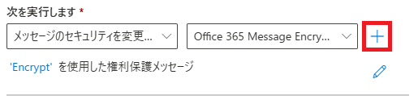

---
lab:
  title: 演習 4 - Microsoft Purview Message Encryption をデプロイする
  module: Module 1 - Implement Information Protection
  description: Microsoft Purview Message Encryption を適用するメール フロー ルールを構成し、免責事項を追加して、暗号化されたメールの動作を検証します。
  duration: 45 minutes
  level: 100
  islab: true
  primarytopics:
    - Microsoft Purview
---

# ラボ 1 - 演習 4 - Microsoft Purview Message Encryption をデプロイする

Contoso Ltd. の情報セキュリティ管理者である Joni Sherman は、部門間で交換される機密情報を保護するために、セキュリティで保護されたメール通信を実装しています。 この取り組みの一環として、Exchange 管理センターを使用して Microsoft Purview Message Encryption (OME) を構成し、財務部門から送信されたメッセージを自動的に暗号化し、メッセージが安全に送信されたことを明確に通知します。

**タスク**:

1. 財務部門からのメッセージを暗号化するメール フロー ルールを作成する
1. 暗号化されたメッセージに免責事項を追加する
1. メール フロー ルールを有効にする  
1. メッセージの暗号化を検証する

**推定所要時間:** 30 分

## タスク 1 - 財務部門からのメッセージを暗号化するメール フロー ルールを作成する

このタスクでは、Exchange 管理センターを使用して、財務チーム グループのメンバーから送信されるすべてのメッセージに Microsoft Purview Message Encryption を適用するメール フロー ルールを作成します。

1. **Microsoft Edge** で `https://admin.exchange.microsoft.com` に移動し、JoniS@WWLxZZZZZZ.onmicrosoft.com としてサインインします (この ZZZZZZ は、自分専用のテナント プレフィックスに置き換えてください)。

1. 左側のナビゲーション ウィンドウで **[メール フロー]** を展開し、**[ルール]** を選択します。

1. **[ルール]** ページで、**[+ ルールの追加]** > **[Office 365 Message Encryption と権利保護をメッセージに適用する]** を選択します。

1. **[ルール条件の設定]** ページで、以下のように構成します。

   - **名前**: `Encrypt messages from Finance department`

   - **[このルールを適用する条件] **セクションで、以下のように構成します。

      - ドロップダウン 1:**送信者**

      - ドロップダウン 2: **[このグループのメンバーです]** については、**[メンバーの選択]** ポップアップで **[財務チーム]** と **[保存]** を選択します。

   - **[以下を実行します]** セクション:

     - 既定の **[メッセージのセキュリティを変更する]** と **[Office 365 Message Encryption と権利保護を適用する]** をオンのままにします

     - **[以下を実行します]** セクションの **[1 つ選択する]** リンクを選択します。

       ![Exchange 管理センターで [1 つ選択する] を選択する場所を示すスクリーンショット。](../Media/rights-protect-message-options.png)

     - **[RMS テンプレートの選択]** ポップアップで **[暗号化]** を選択し、**[保存]** を選択します。

     - **[ルール条件の設定]** ページで **[次へ]** を選択します。

1. **[ルールの設定]** ページで、既定値を選択したままにして、**[次へ]** を選択します。

1. **[レビューと完了]** ページでメール フロー ルールを確認し、**[完了]** を選択します。

1. メール フロー ルールが作成されたら、**[完了]** を選択します。

Microsoft Purview Message Encryption を使用して財務部門から送信されたメッセージを暗号化するメール フロー ルールの作成はこれで完了です。 これにより、機密性の高い財務通信が組織外に送信される前に確実に保護されます。

## タスク 2 - 暗号化されたメッセージに免責事項を追加する

次に、既存の暗号化ルールを変更して免責事項を追加します。 この免責事項は、メッセージが Contoso Ltd. によって安全に送信されたことを受信者に通知する、メッセージのブランド化の単純な形式として機能します。

1. **[ルール]** ページで、新しく作成した **[財務部門からのメッセージを暗号化する]** を選択します。

1. **[財務部門からのメッセージを暗号化する]** ポップアップで、**[ルール条件の編集]** を選択します。

1. 別のアクションを追加するには、**[以下を実行します]** セクションの右側にある **+** を選択します。

   

1. 新しく作成された **[And]** セクション:

   - ドロップダウン 1:**メッセージに免責事項を適用する**

   - ドロップダウン 2: **免責事項を追加する**。

   - ドロップダウンで **[テキストの入力]** を選択し、**[免責事項のテキストを指定します]** ポップアップに「`This email has been encrypted and sent securely by Contoso Ltd.`」と入力します。

   - ポップアップの下部にある **[保存]** を選択します。

   - フォールバック アクションを追加するには、リンクを選択します。 **[フォールバック アクションを指定します]** ポップアップで **[折り返す]** を選択し、ポップアップの下部にある **[保存]** を選択します。

1. 下部の **[財務部門からのメッセージを暗号化する]** ポップアップで **[保存]** を選択します。

1. ルールが変更されると、"**トランスポート ルールが正常に更新されました**" というメッセージが表示されます。

1. ポップアップの右上隅にある **[X]** を選択して、ポップアップを閉じます。

暗号化ルールを更新して、保護された各メッセージに免責事項を追加しました。 これにより、メールが暗号化され、Contoso Ltd. から安全に送信されたことが受信者にとって明確になります。

## タスク 3 - メール フロー ルールを有効にする

既定では、新しいメール フロー ルールは無効な状態で作成されます。 このタスクでは、暗号化ルールを有効にして、財務部門からのメッセージの保護を開始できるようにします。

1. **[ルール]** ページで、新しく作成した **[財務部門からのメッセージを暗号化する]** に対して **[無効]** を選択します。

1. **[財務部門からのメッセージを暗号化する]** ポップアップで、**[ルールを有効または無効にする]** の下のトグルを **[有効]** に設定します。

1. メール フロー ルールは自動的に有効になります。 "**ルールの状態を更新しています。お待ちください...**" というメッセージが表示されます。ルールが有効になると、"**ルールの状態が正常に更新されました**" というメッセージが表示されます。

1. ポップアップの右上隅にある **[X]** を選択して、ポップアップを閉じます。

    > [!note] **注:ルールの伝達**
    >
    > 変更が適用されるには数分かかる場合があります。 検証に失敗した場合は、数分待ってから、もう一度テストを送信します。

暗号化ルールがアクティブになり、財務部門から送信されるメッセージに対して Microsoft Purview Message Encryption が適用されます。 今後、財務ユーザーから送信されるメッセージは自動的に暗号化され、Contoso Ltd. の免責事項が含まれるようになります。

## タスク 4 - メッセージの暗号化を検証する

このタスクでは、財務部門のメンバーからテスト メールを送信し、Microsoft Purview Message Encryption が自動的に適用され、セキュリティで保護されたメッセージの通知が受信者に表示されることを確認します。

> [!alert] 一部のラボ環境では、外部メールの配信がブロックされる場合があります。 このタスクは、想定どおりに完了しない可能性があります。

1. InPrivate ウィンドウで **Microsoft Edge** を開くには、タスク バーから Microsoft Edge を右クリックし、**[新しい InPrivate ウィンドウ]** を選択します。

1. **`https://outlook.office.com`** に移動し、`LynneR@WWLxZZZZZZ.onmicrosoft.com` として Outlook on the web にログインします (この ZZZZZZ は、ラボ ホスティング プロバイダーから提供された自分専用のテナント プレフィックスです)。 ユーザー アカウントのパスワードは、ラボ ホスティング プロバイダーから提供されます。

1. **[サインインの状態を維持しますか?]** ダイアログボックスで、**[今後、このメッセージを表示しない]** チェックボックスをオンにして、**[いいえ]** を選択します。

1. Outlook on the web で、**[新しいメール]** を選択します。

1. **[To]** に、テナント ドメインには存在しない、個人用またはその他サード パーティのメール アドレスを入力します。 メールの件名に「**`Secret Message`**」と入力し、本文には「**`My super-secret message.`**」と入力します。

1. **[送信]** を選択してメッセージを送信します。 Outlook ウィンドウは開いたままにしておきます。

1. 新しいウィンドウで個人用のメール アカウントにサインインし、Lynne Robbins からのメッセージを開きます。 メッセージを Microsoft アカウント (@outlook.com など) に送信した場合、自動的に開かれることがあります。 メールを他のメール サービス (@gmail.com など) に送信した場合、暗号化を処理し、メッセージを読み取る次の手順を実行する必要がある場合があります。

    > [!Note] **注:** 迷惑メール フォルダーに Lynne Robbins からのメッセージがあるかどうかを確認する必要があるかもしれません。

1. **[メッセージを読む]** を選択します。

1. **[ワンタイム パスコードを使用してサインイン]** を選択して、制限時間付きパスコードを受け取ります。

1. 個人用のメール ポータルを開き、**"メッセージを表示するためのワンタイム パスコード"** という件名のメッセージを開きます。

1. パスコードをコピーしてポータルに貼り付け、**[続行]** を選択します。

1. 暗号されたメッセージを確認します。 メールの下部に "**このメールは Contoso Ltd. によって暗号化され、安全に送信されています **" というメッセージが表示されます。

財務部門からのメッセージが自動的に暗号化されることと Contoso の免責事項が含まれることの検証と、Microsoft Purview Message Encryption が想定どおりに動作していることの確認は、これで完了です。
